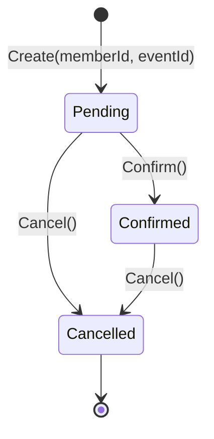
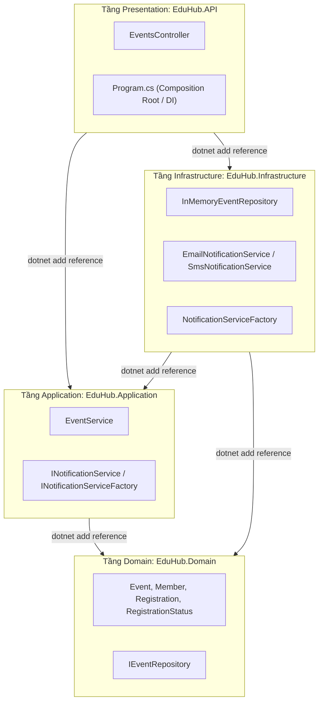

# BÀI LÀM KIỂM TRA GIỮA HỌC PHẦN – ĐỀ SỐ 02
- **Học phần**: Phát triển phần mềm hướng đối tượng (`IN4211`)
- **Họ và tên**: Hồ Ngọc Ái Nhân
- **MSSV**: `0024417258`

---

## Câu 1a

Bốn trụ cột của lập trình hướng đối tượng (OOP) và minh hoạ trong bài làm:

1. **Đóng gói (Encapsulation)**
   - **Giải thích**: Gom dữ liệu (thuộc tính) và các hành vi thao tác trên dữ liệu đó (phương thức) vào chung một lớp, đồng thời che giấu trạng thái nội bộ (`private set`, constructor `private`) để ngăn bên ngoài sửa trực tiếp làm sai lệch quy tắc nghiệp vụ (invariants). Mọi thay đổi trạng thái phải đi qua các phương thức được kiểm soát.
   - **Minh hoạ trong code**:
     - Tệp `EduHub.Domain/Entities/Member.cs` – lớp `Member`: các thuộc tính `Id`, `Email` đều để `{ get; private set; }`, constructor là `private`, và chỉ cho phép khởi tạo thông qua factory method `Member.Create(string email)` có kiểm tra email không rỗng và chứa ký tự `@`.
     - Tệp `EduHub.Domain/Entities/Registration.cs` – lớp `Registration`: thuộc tính `Status` có `private set`, chỉ được chuyển trạng thái hợp lệ qua `Confirm()` và `Cancel()`.

2. **Trừu tượng hoá (Abstraction)**
   - **Giải thích**: Ẩn đi các chi tiết cài đặt phức tạp bên dưới và chỉ phơi bày ra bên ngoài những giao diện (interface/contract) thể hiện "làm cái gì" (what) thay vì "làm như thế nào" (how).
   - **Minh hoạ trong code**:
     - Tệp `EduHub.Domain/Interfaces/IEventRepository.cs` – interface `IEventRepository` và tệp `EduHub.Application/Interfaces/INotificationService.cs` – interface `INotificationService`: lớp `EventService` (`EduHub.Application/Services/EventService.cs`) chỉ gọi `IEventRepository.Add(...)` và `INotificationService.Send(...)` mà không cần biết dữ liệu được lưu trong bộ nhớ hay SQL, hay thông báo được gửi qua Email hay SMS.

3. **Kế thừa (Inheritance)**
   - **Giải thích**: Cho phép một lớp con (derived class) kế thừa các thuộc tính và hành vi từ một lớp cha (base class), giúp tái sử dụng mã nguồn và mở rộng chức năng theo mối quan hệ *is-a*.
   - **Minh hoạ trong code**:
     - Tệp `EduHub.API/Controllers/EventsController.cs` – lớp `EventsController` kế thừa từ lớp `ControllerBase` (`public class EventsController : ControllerBase`) để kế thừa các phương thức xử lý HTTP response của ASP.NET Core như `Ok()`, `CreatedAtAction()`, `NotFound()`, `BadRequest()`, `NoContent()`.
     - Tệp `EduHub.Domain/Entities/BaseEntity.cs` – lớp cơ sở `BaseEntity` chứa định danh `Id`, được các thực thể `Member`, `Event`, `Registration` kế thừa.

4. **Đa hình (Polymorphism)**
   - **Giải thích**: Cho phép các đối tượng thuộc các lớp khác nhau cùng phản hồi một thông điệp (cùng một lời gọi phương thức trên kiểu giao diện/lớp cha) theo những cách thực thi riêng biệt lúc chạy chương trình (runtime).
   - **Minh hoạ trong code**:
     - Tệp `EduHub.Infrastructure/Notifications/EmailNotificationService.cs` (lớp `EmailNotificationService`) và tệp `EduHub.Infrastructure/Notifications/SmsNotificationService.cs` (lớp `SmsNotificationService`) cùng cài đặt interface `INotificationService`. Khi `EventService` gọi `notifier.Send(...)`, tuỳ thuộc vào đối tượng thực tế do `NotificationServiceFactory` trả về theo `channel` (`"email"` hoặc `"sms"`), chương trình sẽ thực thi hành vi gửi Email hoặc gửi SMS tương ứng.

---

## Câu 1b

Hai vấn đề về đóng gói (Encapsulation) của lớp `Member` trong Đoạn mã 1:

1. **Các thuộc tính `Id` và `Email` có setter công khai (`public set;`)**:
   - Bất kỳ lớp nào bên ngoài cũng có thể gán trực tiếp hoặc sửa đổi tuỳ ý các thuộc tính này ở mọi thời điểm (ví dụ dòng 9: `m.Email = "abc";` gán chuỗi không có ký tự `@`, hoặc gán `m.Email = ""` / `m.Id = Guid.Empty`), làm phá vỡ tính toàn vẹn dữ liệu của đối tượng `Member`.
2. **Constructor mặc định là `public Member() { }` không kiểm tra dữ liệu đầu vào**:
   - Cho phép bên ngoài dùng toán tử `new Member()` (dòng 8) để tạo ra một đối tượng `Member` ở trạng thái không hợp lệ ngay từ đầu (`Id` bằng `Guid.Empty`, `Email` bằng `null` hoặc rỗng) mà không bắt buộc đi qua bất kỳ bước kiểm tra (validation) quy tắc nghiệp vụ nào.

---

## Câu 2a

Sơ đồ trạng thái của `Registration` bằng Mermaid (`stateDiagram-v2`):



---

## Câu 3a

Ba nguyên lý SOLID mà lớp `EventService` trong Đoạn mã 2 vi phạm:

1. **SRP (Single Responsibility Principle – Nguyên lý đơn trách nhiệm)**
   - **Số dòng vi phạm**: Dòng `3–15` (cụ thể: dòng `6–7` kiểm tra dữ liệu đầu vào của sự kiện; dòng `8–9` mở kết nối `SqlConnection` và lưu CSDL; dòng `10` ghi log ra tệp `log.txt`; dòng `11–14` phân nhánh chọn kênh và gửi thông báo).
   - **Giải thích**: Lớp `EventService` đảm nhận quá nhiều trách nhiệm khác nhau trong cùng một phương thức `CreateEvent`: vừa kiểm tra luật nghiệp vụ của `Event`, vừa lưu trữ dữ liệu (persistence), vừa ghi log (file I/O), vừa điều phối và gửi thông báo. Khi bất kỳ yếu tố nào (cấu trúc bảng SQL, định dạng file log, hay cách gửi thông báo) thay đổi, `EventService` đều phải sửa đổi.

2. **OCP (Open/Closed Principle – Nguyên lý đóng/mở)**
   - **Số dòng vi phạm**: Dòng `11–14` (`if (channel == "email") ... else if (channel == "sms") ...`).
   - **Giải thích**: Logic chọn kênh thông báo đang viết cứng bằng cấu trúc rẽ nhánh `if / else if`. Mỗi khi hệ thống cần mở rộng thêm kênh thông báo mới (ví dụ: Slack, Push Notification, Zalo), ta buộc phải mở lớp `EventService` ra sửa trực tiếp mã nguồn để thêm nhánh `else if` mới thay vì chỉ thêm lớp cài đặt mới.

3. **DIP (Dependency Inversion Principle – Nguyên lý đảo ngược phụ thuộc)**
   - **Số dòng vi phạm**: Dòng `8` (`new SqlConnection(...)`), dòng `10` (`File.AppendAllText(...)`), dòng `12` (`new EmailSender()`), dòng `14` (`new SmsSender()`).
   - **Giải thích**: Lớp nghiệp vụ bậc cao (`EventService`) đang phụ thuộc trực tiếp và tự khởi tạo (`new`) các lớp cài đặt cụ thể bậc thấp (`SqlConnection`, `File`, `EmailSender`, `SmsSender`) thay vì phụ thuộc vào các abstraction (`IEventRepository`, `INotificationService` / `INotificationServiceFactory`) được tiêm (inject) qua constructor. Điều này làm `EventService` gắn chặt vào hạ tầng và không thể kiểm thử độc lập bằng Mock.

---

## Câu 4b

### Phân biệt `git merge` và `git rebase`

| Tiêu chí | `git merge` | `git rebase` |
|---|---|---|
| **Cơ chế hoạt động** | Kết hợp hai nhánh bằng cách giữ nguyên lịch sử của cả hai nhánh và tạo ra một **merge commit** mới (nếu không phải fast-forward). | Đưa các commit của nhánh hiện tại lên trên đỉnh (tip) của nhánh đích bằng cách **tạo lại các commit mới** (với mã SHA-1 mới) nối tiếp sau nhánh đích. |
| **Hình dạng lịch sử Git** | Lịch sử có cấu trúc phân nhánh và gộp nhánh (graph có nhánh rẽ), phản ánh đúng trình tự thời gian thực tế. | Lịch sử thẳng hàng, tuyến tính (linear history), không có merge commit dư thừa. |
| **Ảnh hưởng tới lịch sử cũ** | Không viết lại lịch sử commit đã có (an toàn cho nhánh dùng chung). | **Viết lại lịch sử commit** (thay đổi commit hash của các commit được rebase). |

### Khi nào KHÔNG nên dùng `git rebase`?
- **Không dùng `git rebase` trên các nhánh công khai / nhánh dùng chung** (như `main`, `develop`, hoặc bất kỳ nhánh nào đã `push` lên remote mà có thành viên khác trong nhóm đang kéo về làm việc cùng).
- **Lý do**: Vì `rebase` viết lại lịch sử và tạo commit hash mới, nếu rebase một nhánh đã chia sẻ cho người khác sẽ làm lịch sử giữa máy cá nhân và kho chung bị lệch nhau, buộc phải `git push --force` và gây xung đột/mất commit của các thành viên khác (Quy tắc vàng của Rebase – *Golden Rule of Rebasing*).

---

## Câu 5a

### Sơ đồ 4 lớp của Clean Architecture và chiều phụ thuộc



### Phân bổ các thành phần vào từng lớp (project)

| Thành phần | Project (Lớp) | Đường dẫn tệp trong Solution |
|---|---|---|
| `Event` | `EduHub.Domain` | `EduHub.Domain/Entities/Event.cs` |
| `IEventRepository` | `EduHub.Domain` *(được re-export/sử dụng tại `EduHub.Application`)* | `EduHub.Domain/Interfaces/IEventRepository.cs` |
| `EventService` | `EduHub.Application` | `EduHub.Application/Services/EventService.cs` |
| `InMemoryEventRepository` | `EduHub.Infrastructure` | `EduHub.Infrastructure/Repositories/InMemoryEventRepository.cs` |
| `EventsController` | `EduHub.API` | `EduHub.API/Controllers/EventsController.cs` |

### Chiều tham chiếu giữa các project (`dotnet add reference`)
- `EduHub.Domain`: **Không** tham chiếu tới bất kỳ project nào (nằm ở tâm của Clean Architecture).
- `EduHub.Application` $\rightarrow$ tham chiếu `EduHub.Domain`.
- `EduHub.Infrastructure` $\rightarrow$ tham chiếu `EduHub.Application` và `EduHub.Domain`.
- `EduHub.API` $\rightarrow$ tham chiếu `EduHub.Application`, `EduHub.Infrastructure` (và `EduHub.Domain` bắc cầu) để cấu hình Dependency Injection tại `Program.cs`.
- `EduHub.Tests` $\rightarrow$ tham chiếu `EduHub.Domain`, `EduHub.Application`, `EduHub.Infrastructure`.

---

## Câu 5b

Project `EduHub.Domain` **không được** tham chiếu tới `EduHub.Infrastructure` vì:

1. **Tuân thủ Dependency Rule (Quy tắc phụ thuộc của Clean Architecture)**: Mọi sự phụ thuộc mã nguồn chỉ được phép hướng từ các tầng bên ngoài vào các tầng bên trong. `EduHub.Domain` là tầng lõi trong cùng (chứa các thực thể và quy tắc nghiệp vụ cốt lõi của bài toán), còn `EduHub.Infrastructure` là tầng ngoài cùng (chứa chi tiết kỹ thuật như CSDL, InMemory, File, Email/SMS).
2. **Bảo vệ tính độc lập của nghiệp vụ (Nguyên lý DIP)**: Nếu `EduHub.Domain` tham chiếu `EduHub.Infrastructure`, các quy tắc nghiệp vụ cốt lõi sẽ bị gắn chặt vào công nghệ hạ tầng cụ thể. Khi thay đổi công nghệ lưu trữ (từ InMemory sang SQL Server/Entity Framework) hoặc dịch vụ bên ngoài, tầng Domain sẽ bị ảnh hưởng và khó viết Unit Test độc lập.
3. **Tránh phụ thuộc vòng (Circular Dependency)**: Vì `EduHub.Infrastructure` bắt buộc phải tham chiếu tới `EduHub.Domain` để cài đặt các repository cho thực thể (`Event`, `Member`, `Registration`), nên nếu `EduHub.Domain` tham chiếu ngược lại `EduHub.Infrastructure` sẽ gây lỗi vòng lặp tham chiếu không thể biên dịch trong .NET.

---

## Câu 5c

`EventsController` (`EduHub.API/Controllers/EventsController.cs`) với bốn endpoint và mã trạng thái trả về:

| Chức năng | Phương thức và route | Thành công | Lỗi |
|---|---|---|---|
| Lấy danh sách sự kiện của CLB | `GET /api/clubs/{clubId}/events` | `200 OK` | `400 Bad Request` (clubId rỗng) |
| Xem một sự kiện theo Id | `GET /api/events/{id}` | `200 OK` | `404 Not Found` |
| Tạo sự kiện mới cho CLB | `POST /api/clubs/{clubId}/events` | `201 Created` (kèm header `Location`) | `400 Bad Request` (tiêu đề rỗng, sức chứa ≤ 0) |
| Xoá một sự kiện | `DELETE /api/events/{id}` | `204 No Content` | `404 Not Found` |

Ảnh chụp Swagger (một lần gọi thành công, một lần gọi lỗi) lưu trong thư mục `MinhChung/`.

---

## Câu 5d

### Nguyên nhân lỗi khi đăng ký `InMemoryEventRepository` bằng `AddScoped`
- Khi đăng ký dịch vụ bằng `AddScoped<IEventRepository, InMemoryEventRepository>()`, ASP.NET Core DI Container sẽ **khởi tạo một đối tượng `InMemoryEventRepository` mới cho mỗi HTTP request riêng biệt** và huỷ đối tượng đó ngay khi HTTP request kết thúc.
- Bên trong `InMemoryEventRepository`, dữ liệu được lưu vào trường `private readonly List<Event> _events = new();` (không phải `static`), tức là danh sách `_events` thuộc về từng instance của `InMemoryEventRepository`.
- Do đó:
  1. Khi gọi request `POST /api/clubs/{clubId}/events`, DI tạo **Instance #1** của `InMemoryEventRepository`, thêm sự kiện mới vào `_events` của Instance #1 rồi trả về `201 Created`. Kết thúc request `POST`, Instance #1 (cùng danh sách có 1 phần tử đó) bị huỷ.
  2. Ngay sau đó, khi gọi request `GET /api/clubs/{clubId}/events`, đây là một HTTP request mới nên DI tạo **Instance #2** hoàn toàn mới của `InMemoryEventRepository` với danh sách `_events` mới tinh đang rỗng (`Count = 0`), dẫn đến kết quả trả về là mảng rỗng `[]`.

### Cách đã đăng ký trong bài làm để tránh lỗi này
Trong tệp `EduHub.API/Program.cs`, em đăng ký `InMemoryEventRepository` với vòng đời **Singleton** bằng `AddSingleton`:

```csharp
builder.Services.AddSingleton<IEventRepository, InMemoryEventRepository>();
```

- Với `AddSingleton`, DI Container chỉ khởi tạo **duy nhất một instance** của `InMemoryEventRepository` trong suốt thời gian chạy của ứng dụng Web API. Mọi HTTP request (`POST`, `GET`, `DELETE`) đều dùng chung instance này nên dữ liệu trong `List<Event>` được giữ lại xuyên suốt giữa các lần gọi API.

